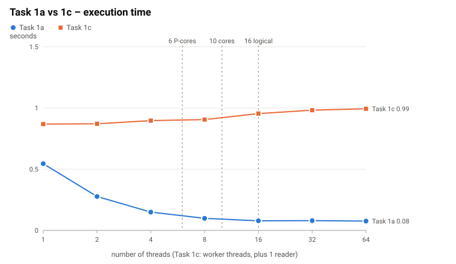
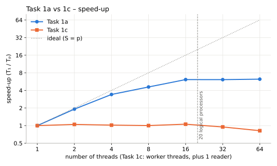
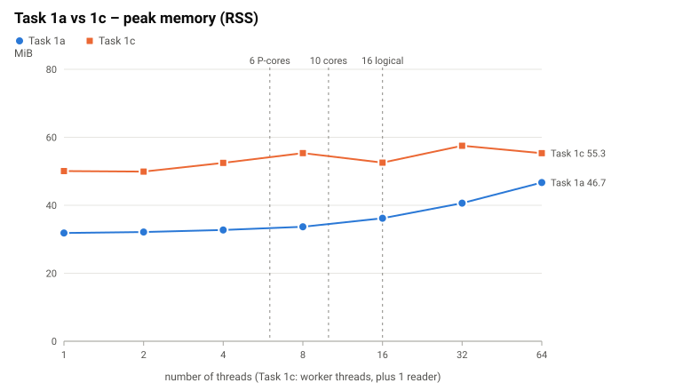
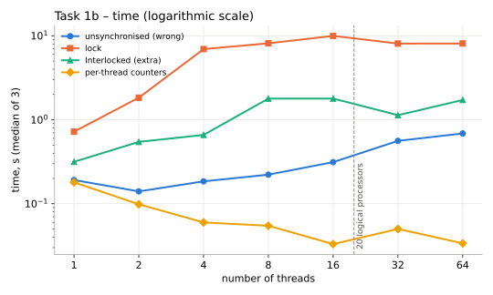
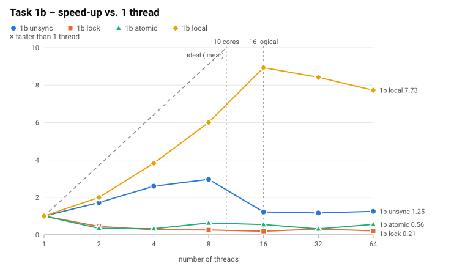
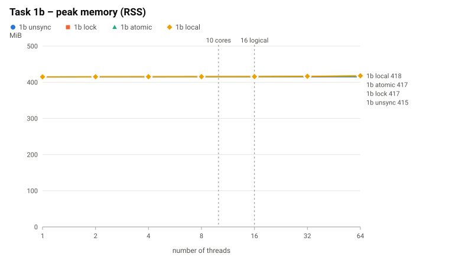
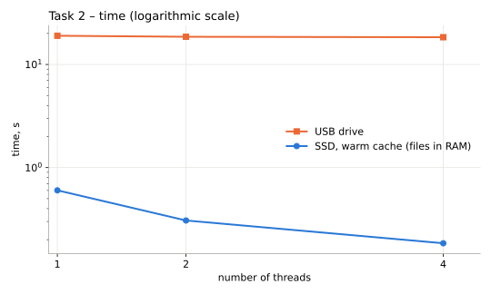
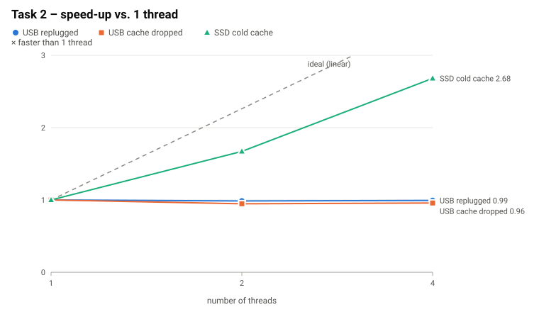
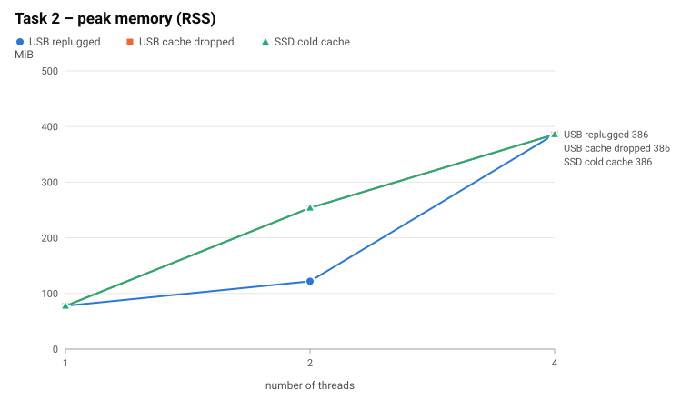

<div align="center">

**TECHNICAL UNIVERSITY OF MOLDOVA**<br>
Faculty of Computers, Informatics and Microelectronics<br>
Department of Software Engineering and Automatics

# LABORATORY WORK NO. 1

### Concurrency in Practice: Multithreading, Shared State and I/O Performance

Course: Network Programming

</div>

| Author | Verified by |
|---|---|
| Frunza Damian, student of group FAF-243 | Cristofor Fistic |

<div align="center">Chișinău — 2026</div>

---

## Contents

1. [Introduction and Objectives](#1-introduction-and-objectives)
2. [Hardware and Software Environment](#2-hardware-and-software-environment)
3. [Theoretical Background](#3-theoretical-background)
4. [Implementation](#4-implementation)
5. [Experimental Results](#5-experimental-results)
6. [Task Questions](#6-task-questions)
7. [Control Questions](#7-control-questions)
8. [Conclusions](#8-conclusions)
9. [Source Code and Build Instructions](#9-source-code-and-build-instructions)

## 1 Introduction and Objectives

Modern processors have many cores, and a program uses them only if it divides its work among
several threads. Whether this actually makes the program faster depends on the hardware and on
how the threads share data and devices. This laboratory work measures it on a real machine with
one simple job: counting the negative, positive and zero numbers among 50 000 000 integers stored
in a text file.

The objectives of the laboratory work are:

1. **Thread scalability (Task 1a):** split one file among 1, 2, 4, 8, 16, 32 and 64 threads,
   measure the time, the speed-up and the peak memory, and relate the point where the speed-up
   stops growing to the number of physical cores and logical processors.
2. **Shared state and synchronisation (Task 1b):** count with unsynchronised shared counters,
   with shared counters protected by a lock and with per-thread counters; check which versions
   are correct and explain what each one costs.
3. **Producer–consumer pipeline (Task 1c):** connect one reader thread and N worker threads with
   a bounded queue, compare the result with Task 1a, and study the effect of the batch size and
   of the queue capacity.
4. **CPU-bound and I/O-bound work (Task 2):** process 8 files stored on a USB flash drive,
   compare with the internal SSD, and explain when more threads help an I/O-bound program.

The program is written in **C# / .NET 10**. The source code, the build instructions and the
commands used for every measurement are given in Section 9. The raw measurements are in
`results/*.csv` and the charts in `results/charts/`.

## 2 Hardware and Software Environment

All measurements were made directly on the physical machine described in Table 1 (no virtual
machine). The operating system, the runtime and the number of logical processors come from the
output of `lab1 info` (`results/logs/info.txt`); the other rows come from Windows (`Get-CimInstance`).

*Table 1: Hardware and software environment*

| Component | Specification |
|---|---|
| CPU | 13th Gen Intel Core i7-13700H (hybrid: 6 Performance-cores with Hyper-Threading + 8 Efficient-cores) |
| Physical cores / logical processors | **14 physical cores** (6 P + 8 E) / **20 logical processors** (6 × 2 + 8 × 1) |
| RAM | 31.7 GiB (as reported by the OS) |
| Internal disk | Internal SSD |
| USB flash drive | **USB 2.0** device, so the link runs at 480 Mbit/s at most. Measured throughput ≈ **19.5 MB/s** (Task 2, one thread) |
| Operating system | Microsoft Windows 10.0.26200 (Windows 11), x64 |
| Language / runtime | C# / .NET 10, runtime .NET 10.0.14; workstation non-concurrent GC; tiered compilation off (methods are fully optimised from the first call) |
| Power | on AC power, Windows power mode **Best performance** |

### 2.1 Architectural Implications

The i7-13700H is a *hybrid* processor: its 20 logical processors are not 20 equal cores. This
determines what the scaling curves can look like:

* **Up to 6 threads**, every thread can run alone on a fast P-core, so an almost linear speed-up
  is expected.
* **From 7 to 14 threads**, the additional threads run either on the 8 E-cores, which are slower
  and simpler than the P-cores, or as the second hardware thread (Hyper-Threading) of a P-core,
  sharing that core's execution units and caches with the first thread. Each of them adds much
  less than a whole P-core.
* **From 15 to 20 threads** only second hardware threads are left, which add even less.
* **Beyond 20 threads** there is no free hardware left: the extra threads only take turns on the
  same 20 logical processors.
* The data file (369.4 MB) fits easily in RAM, so after a warm-up run Task 1 reads it from the OS
  file cache, not from the SSD.

### 2.2 Measurement Methodology

* **Data:** `numbers.txt`, 50 000 000 random integers in [−1 000 000, 1 000 000], 369.4 MB,
  generated with a fixed seed (2026). True totals: **negative 25 000 383, positive 24 999 592,
  zero 25, total 50 000 000**. Every task compares its totals with these and prints OK/WRONG
  (column `correct` in the CSV files). Of the **165** recorded runs of this laboratory work,
  all except the **21** unsynchronised runs of Task 1b (wrong on purpose) gave `correct = true`.
* **Threads** are OS threads created with `new Thread(...)`; the work is split by the program
  itself (no thread pool, no `Parallel.For`).
* **Time** = wall-clock time (`Stopwatch`) from creating the threads until all of them have
  finished and the totals are added up.
* **Peak memory** = peak working set of the process (`Process.PeakWorkingSet64`) in MiB. Every
  configuration runs in a **fresh process**, so the peak belongs to that configuration only.
  About 26 MiB of it is the .NET runtime itself.
* **Repetitions:** every configuration was run 5 times (Task 1a) or 3 times (Task 1b sweep,
  Task 1c); Task 1b main run, the Task 1c batch-size experiment and Task 2 were run once per
  configuration. The runs of all thread counts are interleaved; tables and charts show the
  **median**. Unless `--warmup 0` was given, one unrecorded warm-up run before each series loads
  the file into the OS file cache, so in Task 1 the file is read from RAM, not from the SSD.

## 3 Theoretical Background

### 3.1 Concurrency and Parallelism

*Concurrency* means that several tasks are in progress during the same period of time; on one
processor the scheduler interleaves them. *Parallelism* means that tasks execute at the same
instant on different hardware. Threads always give concurrency, but they run in parallel only up
to the number of logical processors (20 on this machine), and at full speed only while each of
them has a physical core of its own.

### 3.2 Speed-up, Efficiency and Amdahl's Law

If T<sub>1</sub> is the time with one thread and T<sub>p</sub> the time with p threads, the
speed-up and the parallel efficiency are

```math
S(p) = \frac{T_1}{T_p}, \qquad E(p) = \frac{S(p)}{p}
```

If only a fraction f of the work can be done in parallel and the rest, 1 − f, is sequential
(starting the threads, adding up the totals, reading the input on a single thread), Amdahl's law
limits the speed-up:

```math
S(p) = \frac{1}{(1 - f) + \frac{f}{p}} \le \frac{1}{1 - f}
```

Even with infinitely many threads the time cannot fall below the time of the sequential part. In
practice the speed-up is lower still, because extra threads bring costs of their own (creating
them, scheduling them, competing for shared resources).

### 3.3 Shared State, Race Conditions and Synchronisation

A *data race* happens when two threads access the same memory location at the same time, at
least one of them writes, and nothing orders the accesses. The statement `counter++` is not one
indivisible operation but three steps:

1. **Load** the value from memory into a register;
2. **Add** 1 to the register;
3. **Store** the register back to memory.

If two threads interleave these steps, one store overwrites the other and an increment is lost
(a *lost update*). The usual remedies are:

* **Mutual exclusion** (`lock` / `Monitor`): only one thread at a time executes the critical
  section. It is correct, but the threads are serialised, every acquire and release costs atomic
  operations, and a waiting thread may be put to sleep and woken up by the OS.
* **Atomic instructions** (`Interlocked.Increment`, `lock xadd` on x86): each increment is
  indivisible without a lock, but all threads still write to the same memory.
* **No sharing:** each thread counts in private variables and the results are added once at the
  end (a *reduction*). There is nothing to synchronise while counting.

Shared data also has a hardware cost: caches work with 64-byte *cache lines*, and a line written
by several cores has to move from core to core on every write (cache-coherence traffic), even
when the accesses are correctly synchronised.

### 3.4 Producer–Consumer Pattern and Bounded Queues

In the producer–consumer pattern, producers put work items into a queue and consumers take them
out. A *bounded* queue of capacity C makes the producer wait when C items are already waiting
(**back-pressure**, which keeps the memory bounded) and makes the consumers wait when it is empty.
Every `Add` and `Take` is a synchronised operation, so items are grouped into **batches** to
spread this cost over many lines. Unlike a split made in advance, a queue balances the load
automatically: a free consumer simply takes the next item.

### 3.5 CPU-Bound and I/O-Bound Work

A program is *CPU-bound* when its time goes on computation; more cores make it faster. It is
*I/O-bound* when most of its time is spent waiting for a device or for the network. Concurrency
helps I/O-bound work only when the waits are **independent** and can overlap (for example many
network requests, each waiting for a different server); it does not help when all threads queue
for **one device that is already at its bandwidth limit**.

## 4 Implementation

The whole laboratory work is one console program, `Lab1`; the task and its parameters are chosen
with command-line arguments (Section 9). Threads are always real OS threads created with
`new Thread(...)`. Table 2 lists the source files.

*Table 2: Structure of the source code*

| File | Contents |
|---|---|
| `Program.cs` | command dispatch and `help` text |
| `Args.cs` | command-line parser (`--key value`, `--flag`) |
| `Numbers.cs` | line parser, `Counts`, splitting a file into line-aligned byte ranges |
| `Measure.cs` | peak memory, the expected totals, the machine-readable result line |
| `DataTools.cs` | `gen` (data file), `split` (8 parts), `info` (hardware) |
| `Task1a.cs` | Task 1a – each thread reads and parses its own part of the file |
| `Task1b.cs` | Task 1b – unsynchronised / lock / per-thread counters (+ `Interlocked` as an extra) |
| `Task1c.cs` | Task 1c – one reader, N workers, bounded `BlockingCollection` |
| `Task2.cs` | Task 2 – one file = one unit of work, `File.ReadAllBytes`, files split among threads |
| `Bench.cs` | runs a task for several thread counts, each run in a fresh process, writes CSV |
| `Charts.cs` | turns the CSV files into SVG charts (time, speed-up, peak memory) and a table |

### 4.1 Dataset

`lab1 gen` writes `data/numbers.txt` (50 000 000 integers, one per line, see Section 2.2) and
`data/numbers.txt.counts` with the true totals. For Task 2, `lab1 split` divides it, in order,
into `part_1.txt … part_8.txt` (6 250 000 lines, 46.2 MB each) plus `expected.counts`. Every run
checks that

```math
N_{negative} + N_{positive} + N_{zero} = 50\,000\,000
```

and compares each of the three totals with the expected value.

### 4.2 Task 1a: Splitting One File Among Threads

Each thread opens the file itself and processes only its own part of it:

1. Thread i of N gets the raw byte range [size·i/N, size·(i+1)/N).
2. Both ends of the range are moved forward to the next line start (`Numbers.AlignToLineStart`),
   so a line belongs to the thread whose range contains its first byte (details in Section 7.2).
3. The thread reads its range in 256 KiB chunks with positional reads (`RandomAccess.Read`),
   parses the bytes directly and counts into local variables.
4. The main thread waits for all threads (`Join`) and adds up the per-thread totals.

### 4.3 Task 1b: Three Ways to Count

The numbers are loaded into an `int[]` first (not measured). Then 16 threads each count
3 125 000 numbers, in one of these versions:

1. **Shared, no synchronisation:** all threads increment the same three shared counters. This
   version is run 3 times, to show that its result changes from run to run.
2. **Shared + lock:** every increment of a shared counter is done inside `lock (gate) { … }`.
3. **Per-thread counters:** each thread counts into its own local variables and the main thread
   adds up the per-thread totals after `Join`.
4. **Extra – shared + `Interlocked`:** `Interlocked.Increment` on the shared counters (atomic
   instructions, no lock). It is not required and was added for comparison.

### 4.4 Task 1c: One Reader, N Workers, Bounded Queue

One reader thread reads the file with `StreamReader.ReadLine()`, puts the lines into
`string[10 000]` batches and adds them to a `BlockingCollection<string[]>` with capacity 100
(a bounded blocking FIFO queue). When the file ends it calls `CompleteAdding()` (closes the
queue). N worker threads take batches until the queue is closed and empty, parse the lines and
count into local variables. The program also records how long the reader waited on a full
queue, how long the workers waited on an empty queue, and the longest the queue ever got. The
batch size and the capacity are parameters (`--batch`, `--capacity`, where 0 means unbounded),
used for the experiments of question 6.

### 4.5 Task 2: Many Files on Slow Storage

`numbers.txt` was split, in order, into `part_1.txt … part_8.txt` (6 250 000 lines, 46.2 MB
each). A file is the unit of work: a thread reads it with **one `File.ReadAllBytes` call into
one `byte[]`**, then parses the buffer and counts. The files are divided into equal contiguous
groups (1 thread: 8 files, 2 threads: 4 + 4, 4 threads: 2 + 2 + 2 + 2). For every file the
program measures how long the read and the parse took; the CSV contains the sums.

Two series were measured:

* **USB flash drive:** the 8 files were copied to the drive and read only from there.
  Before every run the drive was **ejected, unplugged and plugged back in** (`bench --pause`
  waits for this), so nothing came from the OS file cache. One run per configuration. The
  measured throughput of ≈ 19.5 MB/s shows that the data really came from the drive and
  not from RAM.
* **Reference, internal SSD:** the same program on the SSD with a **warm** cache, i.e. the files
  were already in RAM (`results/task2-ssd-warm.csv`). This series is therefore not a measurement
  of the SSD itself, but of the program when reading is (almost) free, which is exactly what is
  needed to separate the cost of parsing from the cost of reading.

```bash
lab1 bench --task 2 --threads 1,2,4 --runs 1 --pause --dir E:\lab1 --csv results\task2.csv
```

## 5 Experimental Results

### 5.1 Task 1a: Counting with Threads

Table 3 shows the median of 5 runs for each number of threads; the efficiency is E = S/p. The
totals were correct in every run. Figures 1–3 show Task 1a and Task 1c together, so that they can
be compared (question 5).

*Table 3: Task 1a – time, speed-up, efficiency and peak memory vs. number of threads*

| Threads | Time, s | Speed-up | Efficiency | Peak memory, MiB | Totals correct |
|---:|---:|---:|---:|---:|---|
| 1 | 0.491 | 1.00× | 100.0 % | 26.8 | yes (5/5) |
| 2 | 0.256 | 1.91× | 95.7 % | 27.1 | yes |
| 4 | 0.144 | 3.41× | 85.2 % | 27.6 | yes |
| 8 | 0.107 | 4.58× | 57.2 % | 28.6 | yes |
| 16 | 0.080 | 6.13× | 38.3 % | 31.3 | yes |
| 32 | 0.080 | 6.11× | 19.1 % | 35.5 | yes |
| 64 | 0.079 | 6.23× | 9.7 % | 44.1 | yes |



*Figure 1: Task 1a and Task 1c – wall-clock time vs. number of threads (logarithmic scale)*



*Figure 2: Task 1a and Task 1c – speed-up vs. number of threads*



*Figure 3: Task 1a and Task 1c – peak memory vs. number of threads*

### 5.2 Task 1b: Three Ways to Count

Table 4 shows the main run (`results/task1b.csv`, `--threads 16`); the machine has 20 logical
processors.

*Table 4: Task 1b – main run with 16 threads*

| Version | Time, s | Negative | Positive | Zero | Total | Correct |
|---|---:|---:|---:|---:|---:|---|
| 1. shared, no synchronisation – run 1 | 0.231 | 7 144 607 | 7 096 284 | 25 | 14 240 916 | **no**, 35 759 084 updates lost (71.5 %) |
| 1. shared, no synchronisation – run 2 | 0.116 | 5 834 924 | 5 826 871 | 25 | 11 661 820 | **no**, 38 338 180 updates lost (76.7 %) |
| 1. shared, no synchronisation – run 3 | 0.116 | 5 491 932 | 5 472 137 | 25 | 10 964 094 | **no**, 39 035 906 updates lost (78.1 %) |
| 2. shared + lock | 2.990 | 25 000 383 | 24 999 592 | 25 | 50 000 000 | yes |
| extra: shared + `Interlocked` | 1.741 | 25 000 383 | 24 999 592 | 25 | 50 000 000 | yes |
| 3. per-thread counters | **0.031** | 25 000 383 | 24 999 592 | 25 | 50 000 000 | yes |

The same four versions were also run with 1–64 threads (`results/task1b-sweep.csv`, median of 3
runs): Table 5 and Figures 4–6 (time on a logarithmic scale). With one thread the unsynchronised
version is correct (nobody to race with); with 2 or more threads it was wrong in **every** run
(21 of 21 runs).

*Table 5: Task 1b – time of the four versions vs. number of threads (median of 3 runs, seconds)*

| Threads | unsync, s | lock, s | Interlocked, s | per-thread, s |
|---:|---:|---:|---:|---:|
| 1 | 0.192 (correct) | 0.721 | 0.316 | 0.180 |
| 2 | 0.140 (wrong) | 1.831 | 0.545 | 0.099 |
| 4 | 0.185 (wrong) | 6.937 | 0.660 | 0.060 |
| 8 | 0.222 (wrong) | 8.135 | 1.786 | 0.055 |
| 16 | 0.313 (wrong) | 9.972 | 1.788 | 0.033 |
| 32 | 0.561 (wrong) | 8.072 | 1.133 | 0.050 |
| 64 | 0.687 (wrong) | 8.091 | 1.720 | 0.034 |

Peak memory is ≈ 410 MiB in every case: it is the 200 MB `int[]` plus the memory used
while loading it, and does not depend on the version or the number of threads.



*Figure 4: Task 1b – time of the four versions vs. number of threads (logarithmic scale)*



*Figure 5: Task 1b – speed-up of the four versions, each relative to its own 1-thread time*



*Figure 6: Task 1b – peak memory vs. number of threads*

### 5.3 Task 1c: Producer and Consumers

Table 6 shows the median of 3 runs with batches of 10 000 lines and a queue capacity of 100. The
charts of Task 1c are the orange series in Figures 1–3. The third run of every series was about
22–28 % slower than the first one for 1–32 workers (for example 1.07 s against 0.84 s with one
worker), so the medians carry an uncertainty of about ±10 %; differences smaller than that
(for example between 1 and 16 workers) are not significant.

*Table 6: Task 1c – time, peak memory and queue statistics vs. number of workers*

| Workers | Time, s | Speed-up | Peak memory, MiB | Reader found the queue full | Longest queue | Avg. worker wait on empty queue | Correct |
|---:|---:|---:|---:|---:|---:|---:|---|
| 1 | 0.923 | 1.00× | 56.1 | 0 times | 3–15 batches | 0.32–0.38 s | yes |
| 2 | 0.881 | 1.05× | 48.5 | 0 times | 3–4 batches | 0.54–0.69 s | yes |
| 4 | 0.905 | 1.02× | 48.3 | 0 times | 3–4 batches | 0.75–0.91 s | yes |
| 8 | 0.922 | 1.00× | 48.3 | 0 times | 2–7 batches | 0.78–0.97 s | yes |
| 16 | 0.872 | 1.06× | 47.5 | 0 times | 3–4 batches | 0.80–1.01 s | yes |
| 32 | 0.974 | 0.95× | 47.8 | 0 times | 4 batches | 0.87–1.09 s | yes |
| 64 | 1.128 | 0.82× | 49.7 | 0 times | 5–6 batches | 1.10–1.11 s | yes |

Table 7 shows the extra experiments for question 6 (1 run each for the batch-1 rows, 3 runs for the
unbounded 10 000-line row; `results/task1c-batch1.csv`, `results/task1c-unbounded.csv`,
`results/task1c-batch1-unbounded.csv`).

*Table 7: Task 1c – effect of the batch size and of the queue capacity*

| Configuration | Workers | Time, s | Peak memory, MiB | Longest queue |
|---|---:|---:|---:|---:|
| batch 1 line, capacity 100 | 1 | 20.97 | 39.9 | 100 (full 10 858 times) |
| batch 1 line, capacity 100 | 4 | 55.65 | 40.1 | 100 (full 1 277 times) |
| batch 1 line, capacity 100 | 16 | 72.80 | 40.5 | 100 (full 12 times) |
| batch 10 000, **unbounded** | 1 / 4 / 16 | 0.799 / 0.811 / 0.830 | 48.7 / 48.3 / 49.1 | 4–5 |
| batch 1 line, **unbounded** | 1 | 11.52 | 42.3 | **21 782** |

### 5.4 Task 2: Many Files on Slow Storage

#### 5.4.1 USB Drive

*Table 8: Task 2 on the USB drive*

| Threads | Time, s | Speed-up | Peak memory, MiB | Reading (thread-time sum), s | Parsing (sum), s | Overall MB/s | Correct |
|---:|---:|---:|---:|---:|---:|---:|---|
| 1 | **18.99** | 1.00× | 245.7 | 18.54 | 0.44 | 19.5 | yes |
| 2 | **18.55** | 1.02× | 248.2 | 34.32 | 0.48 | 19.9 | yes |
| 4 | **18.37** | 1.03× | 380.4 | 59.24 | 0.46 | 20.1 | yes |

Table 9 shows what each thread saw. Every thread reads 1/p of the 369.4 MB, so its average read
speed falls in proportion to p, while the overall throughput stays at the limit of the drive.

*Table 9: Task 2 on the USB drive – read time and speed per thread*

| Threads | Average read time per thread | Average read speed per thread | Overall throughput (data / wall time) |
|---:|---:|---:|---:|
| 1 | 18.5 s | 19.9 MB/s | 19.5 MB/s |
| 2 | 17.2 s | 10.8 MB/s | 19.9 MB/s |
| 4 | 14.8 s | 6.2 MB/s | 20.1 MB/s |



*Figure 7: Task 2 – time on the USB drive and on the SSD (logarithmic scale)*



*Figure 8: Task 2 – speed-up on the USB drive and on the SSD*



*Figure 9: Task 2 – peak memory on the USB drive and on the SSD*

#### 5.4.2 Reference: Internal SSD with Warm Cache

*Table 10: Task 2 on the internal SSD, warm page cache (files already in RAM)*

| Threads | Time, s | Speed-up | Reading (sum), ms | Parsing (sum), ms | Peak memory, MiB |
|---:|---:|---:|---:|---:|---:|
| 1 | 0.602 | 1.00× | 121 | 475 | 245.8 |
| 2 | 0.307 | 1.96× | 143 | 460 | 380.1 |
| 4 | 0.185 | 3.26× | 206 | 508 | 380.2 |

With the files in RAM, one thread spends 0.12 s "reading" 369 MB (a memory copy) and 0.47 s
parsing it, so here the work is **CPU-bound** and 2 and 4 threads speed it up (1.96× and 3.26×),
like Task 1a.

**Peak memory grows with the threads** (245.7 → 248.2 → 380.4 MiB for 1, 2 and 4 threads on the USB drive;
245.8 → 380.1 → 380.2 MiB on the SSD), because every thread holds a whole 46 MB file in memory
while it parses it. A 46 MB array is a large object that the .NET GC frees only during a full
collection, so finished buffers are still resident when the next ones are allocated; the peak of
≈ 380 MiB (4 threads on both drives, 2 threads on the SSD) is close to the size of all 8 files
together (369 MB), and even with one thread about five of the eight buffers are still resident
(246 MiB).

## 6 Task Questions

### 6.1 Task 1 Questions

#### 6.1.1 Question 1: At which number of threads does the speed-up stop growing? Relate it to physical cores and logical processors.

At about **16 threads**. The speed-up is 1.91× with 2 threads, 3.41× with 4, 4.58× with 8 and
6.13× with 16; with 32 and 64 threads it is 6.11× and 6.23×, i.e. flat. Up to 4 threads the
efficiency is still 85–96 %, because every thread can run alone on a core; from 4 to 8 and from
8 to 16 threads each doubling of the threads adds only about 34 % (efficiency 57 % and 38 %).
The machine has 14 physical cores (6 P + 8 E) and 20 logical processors. The first 6 threads each
get a fast P-core, which is why the speed-up is almost ideal up to 4 threads. The next threads run
on the slower E-cores or as the second hardware thread of a P-core, which shares the core's
execution units with the first thread, so each of them adds much less than a whole P-core. With
16 threads all 14 physical cores are already busy, and the last ones are only second hardware
threads. That is why 14 cores and 20 logical processors give a speed-up of only about 6×, close
to what 6 full P-cores would give, not 14× or 20×. The measured thread counts are powers of two, so
there is no point between 16 and 32 (for example 20); the plateau is reached at the latest with 16
threads, and beyond the 20 logical processors there is no more hardware to run additional
threads on. The per-thread version of Task 1b, which only reads an array, shows the same picture: 3.0× with
4 threads, 5.4× with 16 and no further gain with 32 and 64 (3.6× and 5.3×; these runs last only
a few tens of milliseconds and are noisy).

#### 6.1.2 Question 2: Why do 32 and 64 threads not help? Are they slower, and why?

They do not help because only 20 threads can run at the same moment; the other threads wait for
a time slice and the same amount of CPU work is just cut into more pieces. On this machine they
are **not measurably slower** for Task 1a (0.080 s and 0.079 s against 0.080 s with 16
threads; the five runs with 16 threads range from 0.077 to 0.086 s). The extra costs exist
(creating and joining 48 more threads, more context switches, more 256 KiB buffers and stacks,
64 boundary searches) but they are a few milliseconds out of 80 ms; one of the five 64-thread
runs, the first of the series, took 0.103 s, which shows that they can become visible. Where
threads compete for a shared resource the extra threads do hurt: Task 1c gets slower with 32 and
64 workers (0.97 s and 1.13 s against 0.87 s with 16), and the unsynchronised counters of Task 1b
go from 0.313 s (16 threads) to 0.687 s (64).

#### 6.1.3 Question 3: Does the peak memory depend on the number of threads? Why?

Yes, but only a little and linearly: 26.8 MiB with 1 thread, 31.3 MiB with 16, 44.1 MiB with 64,
i.e. ≈ 0.28 MiB per additional thread. Each thread has its own 256 KiB read buffer, its own
stack (only the touched pages count) and runtime bookkeeping. The file itself is **never loaded
as a whole**: every thread streams through its part, so memory does not depend on the file size.
The ≈ 26 MiB base is the .NET runtime and the compiled code.

#### 6.1.4 Question 4: Rank the three versions of Task 1b by time. Which of them are correct? Explain each result.

Fastest to slowest with 16 threads: **per-thread counters 0.031 s < unsynchronised 0.12–0.23 s
< (`Interlocked` 1.74 s) < lock 2.99 s** in the main run, and 0.033 s < 0.313 s < 1.788 s <
9.972 s in the sweep (medians of 3). Only the **per-thread** and the **lock** versions (and
`Interlocked`) are correct. The unsynchronised version is wrong every time, by a different amount
each time: 35.8 M, 38.3 M and 39.0 M of the 50 M increments were lost in the main run (72–78 %),
and 16–81 % in the sweep (16–44 % with 2 threads, 69–73 % with 16, 75–81 % with 64).

* *Unsynchronised*: `counter++` is three steps (load, add 1, store). When two threads load
  the same value, both store value + 1 and one increment disappears (lost update). The more
  threads, the more collisions. It is also slow for a version without locks: the three counters
  are in one 64-byte cache line that all cores write to all the time, so the line keeps moving
  from core to core (cache-coherence traffic). It gets slower with more threads (0.140 s with 2,
  0.313 s with 16, 0.687 s with 64 threads) and is slower than one thread (0.192 s) from 8
  threads on. Only `zero` is right (25) in every run, because zeros are so rare that two threads
  almost never update it at the same moment.
* *Lock*: correct because the read-modify-write happens inside one critical section, but
  50 000 000 lock/unlock pairs are executed and only one thread at a time can be inside. The
  threads effectively take turns, the lock itself is a contended shared cache line, and waiting
  threads may be put to sleep and woken up by the OS. Result: with 16 threads it is slower than
  with **one** thread (0.72 s) – 3.0 s in the main run, 8.9–11.5 s in the sweep – and about
  100× (main run) to 300× (sweep) slower than per-thread counters. The time of a contended lock
  varies a lot from run to run, because it depends on how the scheduler hands the lock over; the
  order of magnitude is what matters.
* *Interlocked* (extra): an atomic `lock xadd` instruction is correct and cheaper than a lock,
  but every increment still fights for the same cache line → 1.7–1.8 s with 16 threads.
* *Per-thread*: each thread counts in its own local variables (in CPU registers); nothing is
  shared while counting, and there is one write per thread at the end. No synchronisation, no
  cache-line traffic → it is correct and scales (5.4× from 1 to 16 threads: 0.180 s → 0.033 s).

#### 6.1.5 Question 5: Compare Task 1c with Task 1a. Which one is faster, and why? At which number of workers does Task 1c stop getting faster?

Task 1a is much faster: 0.080 s with 16 threads against 0.87 s for the best 1c configuration
(**≈ 11× faster**); even 1a with a single thread (0.491 s) beats every 1c configuration
(0.87–1.13 s). Task 1c **does not get faster at all: it is already at its best with 1 worker**.
Its time is 0.92 s with 1 worker, 0.87–0.92 s with 2 to 16 workers (a difference inside the
run-to-run spread, see Section 5.3), and then it gets slower: 0.97 s with 32 and 1.13 s with 64
workers. The measurements show why. The reader never once found the queue full (0 events in all
21 runs) and the queue never held more than 7 of the 100 allowed batches (15 in one run), while
the workers spent most of their time waiting for an empty queue to be refilled (one worker:
0.32–0.38 s of 0.92 s, i.e. about 40 %; with 64 workers: 1.1 s, 98 % of the run). The reader's
own running time is 98–100 % of the total time in every run, so the **single reader thread is
the bottleneck**. It does the sequential part of the work: reading, finding line ends,
converting UTF-8 bytes to UTF-16 `string`s and allocating one object per line (50 million short
lived strings plus the batch arrays). The parsing that the workers do in parallel is the cheap
part (one worker is busy for only ≈ 0.55 s). By Amdahl's law the time cannot fall below the
reader's ≈ 0.8–0.9 s, and more workers only add contention on the queue and wake-ups; with 65
threads on 20 logical processors the reader also has to compete for CPU time, which is the likely
reason for the slow-down with 32 and 64 workers. In Task 1a reading and splitting lines are also
done in parallel, directly on bytes, without allocating strings.

#### 6.1.6 Question 6: What would happen with batches of a single line? And with a queue that has no size limit?

*Measured* (Table 7). With **batches of one line** every number costs one `Add` and one `Take`
on the shared queue (locking and signalling, often waking a sleeping thread through the OS):
50 000 000 queue operations instead of 5 000. One worker took **21.0 s (23× slower** than the
0.92 s with batches of 10 000), and more workers made it worse: 4 workers 55.7 s (60×),
16 workers 72.8 s (79×). With 4 and 16 workers the workers waited almost the whole time (48.7 s of
55.7 s and 70.3 s of 72.8 s): the queue's lock is the bottleneck, and every additional thread only
increases the contention. The synchronisation cost per item is larger than the work per item, so
batching is what makes the queue usable.

With an **unbounded queue** and 10 000-line batches nothing changed (0.80–0.83 s, 48–49 MiB),
because here the consumers are faster than the producer and the queue never holds more than 5
batches. The limit matters when the producer is faster than the consumers. Then an unbounded
queue keeps growing and memory is no longer bounded: with batches of one line and one worker the
queue grew to **21 782 entries** instead of stopping at 100 (and that run was even faster, 11.5 s
against 21.0 s, because the reader never had to wait for free space and the queue was full
10 858 times in the bounded run). Here the memory stayed small (42 MiB), since single lines are
tiny; but with 10 000-line batches and slow workers the whole file (≈ 50 million strings,
gigabytes) could end up in the queue, up to an out-of-memory error. A bounded queue gives
**back-pressure**: the reader is made to wait, and the memory stays below 100 × 10 000 lines,
tens of megabytes of strings.

### 6.2 Task 2 Questions

#### 6.2.1 Question 1: Compare the time on one thread with Task 1a on one thread. On the USB drive, is the work CPU-bound or I/O-bound?

**I/O-bound.** With one thread Task 2 took **18.99 s** on the USB drive, against **0.491 s**
for Task 1a and 0.60 s for the same Task 2 on the SSD with a warm cache: **39× slower**
than Task 1a for exactly the same numbers and the same parsing code. Of the 18.99 s,
**18.54 s (97.6 %) were spent waiting in `ReadAllBytes`** and only **0.44 s
(2.3 %) parsing**. The parsing time is about the same as with the files in RAM (0.47 s) and
as in Task 1a (0.49 s), so the CPU did not do more work; it just waited. The throughput is
**19.5 MB/s**, the limit of this drive, while one core can parse about 835 MB/s
(369.4 MB in 0.44 s). The CPU was idle more than 97 % of the time.

#### 6.2.2 Question 2: On the USB drive, do more threads help? Why not, when lecture 1 showed that I/O-bound work benefits from concurrency?

**No.** 1 / 2 / 4 threads: 18.99 / 18.55 / 18.37 s (speed-up 1.00 / 1.02 / 1.03).
The per-thread numbers (Table 9) show why. Every thread waits for **the same single device**,
and its bandwidth is fixed at ≈ 20 MB/s. One thread reading sequentially already uses all of
it. With 2 threads each gets about half (10.8 MB/s), with 4 threads about a quarter (6.2 MB/s):
the overall throughput stays at 19.5–20.1 MB/s, so the total time stays the same. The tiny gain
(0.4 s with 2 and 0.6 s with 4 threads, from one run each) is of the same order as the total
parsing time (0.44–0.48 s), which is the only work that can overlap with reading; it is too small
to matter.

Concurrency helps I/O-bound work when the waits are **independent latencies** (e.g. many network
requests, each waiting for a different remote server, while the link and the CPU are idle): then
many waits overlap. It does not help when all threads queue for **one resource that is already at
its throughput limit**, which is exactly what a USB drive is.

## 7 Control Questions

### 7.1 What is the difference between a physical core and a logical processor? How did it show in your charts?

A physical core is real execution hardware: its own arithmetic units, registers, and L1/L2
caches. A logical processor is what the OS schedules threads on. With Hyper-Threading (SMT)
one core appears as two logical processors. They have separate register sets, but they share
the core's execution units and caches, so two threads on one core run only ≈ 20–30 % faster
than one, not 2×. This CPU has 6 P-cores × 2 + 8 E-cores × 1 = 20 logical processors on 14 physical cores, and the
E-cores are slower than the P-cores. In the charts (Figure 2): Task 1a scales
almost linearly up to 4 threads (3.41×), then flattens (4.58× with 8, 6.13× with 16 threads,
far from 16×) and stays at ≈ 6.1–6.2× for 32 and 64 threads, because there is no more
hardware to run them on.

### 7.2 How did you make sure that no line was counted twice or skipped at the boundary between two parts of the file?

Each thread gets a raw byte range [size·i/N, size·(i+1)/N). Rule: *a line belongs to the
thread whose range contains its first byte.* Every thread moves **both** ends of its range
with the same function, `AlignToLineStart(offset)`: if the byte before `offset` is `\n`, then
`offset` is already a line start; otherwise move forward to the byte after the next `\n`. Thread
i's aligned end is computed exactly like thread i+1's aligned start, so the aligned ranges
fit together with no gap and no overlap, and each thread parses only complete lines inside its
range. Check: every run of every thread count (35 runs of Task 1a with 1–64 threads) gave
exactly 50 000 000 numbers and the same totals as the generator (`correct = true`); an error at
a boundary would change the totals.

### 7.3 Explain step by step how unsynchronised shared counters lose updates.

`negative++` is executed as: (1) load the value from memory into a register, (2) add 1,
(3) store the register back to memory. Even a single `inc [mem]` instruction does these three
steps without the `lock` prefix and is not atomic across cores. Example with `negative = 100`:

1. thread A loads 100;
2. thread B loads 100;
3. A computes 101 and stores 101;
4. B computes 101 and stores 101.

Two numbers were counted but the counter grew by one, and B's store overwrote A's update. With
16 threads hitting the same counters millions of times, this happened to 69–78 % of the
increments in our runs, and differently in each run.

### 7.4 Why are per-thread counters faster than shared counters protected by a lock?

With a lock every one of the 50 M increments needs an acquire and a release (atomic
instructions on the lock's memory). Only one thread at a time can hold the lock, so the threads
run one after another instead of in parallel. The lock and the counters move between the
cores' caches on every operation, and a thread that finds the lock taken may be put to sleep
and woken up by the OS. Per-thread counters share nothing: they stay in registers, need no
atomic instruction and no cache-line transfer, and are combined once after `Join`. Measured with
16 threads: 0.031 s against 2.99 s in the main run (≈ 100×) and 0.033 s against 9.97 s in the
sweep (≈ 300×).

### 7.5 What does "I/O-bound" mean for a USB drive, and for a server waiting on the network? Why does concurrency help in only one of the two cases?

I/O-bound means the program spends most of its time waiting for input/output, not computing.

* For the **USB drive** the limit is the **bandwidth of one device**: a single sequential reader
  already keeps it busy, so more threads only share the same MB/s. Measured: one thread read at
  19.9 MB/s; with 2 threads each got 10.8 MB/s, with 4 threads each got 6.2 MB/s, and the total
  time did not change (18.99 s, 18.55 s, 18.37 s).
* For a **server waiting on the network** the time goes on **latency**: each request waits,
  e.g., 100 ms for a remote machine to answer, while the network link and the CPU are mostly
  idle. Those waits are independent of each other, so many requests can wait at the same time
  and 100 concurrent requests take about as long as one.

Concurrency helps when it overlaps waiting on *independent* resources, and does not help when
the threads queue for the *same* saturated resource.

### 7.6 What is the difference between dividing work into equal parts in advance and taking it from a queue? When is each one better?

* *Static partitioning* (Task 1a, Task 2): each thread knows its part from the start. There is
  no coordination during the work, no shared state, no allocations, and good locality, but
  the total time is the time of the **slowest** part. It is best when the work splits evenly,
  its size is known in advance (a file you can seek in, an array), and the cores are equal.
* *A shared queue* (Task 1c): threads take the next piece when they are free, which **balances
  the load automatically**. That is what you need when items have different costs or the cores
  are not equal. It also works for a stream whose size is unknown and that can only be read in
  order. The price is synchronisation on every take, so items must be batched (batch = 1 was
  23–79× slower), and a single producer can become the bottleneck (it was in 1c).

The queue is better for uneven or unknown work and streaming input; static parts are better for
uniform, splittable work.

## 8 Conclusions

1. **CPU-bound work and the hardware limit.** Task 1a, Task 1b (per-thread counting) and Task 1c,
   and Task 2 with the files in RAM, are CPU-bound. Evidence: (1) the time falls almost in
   proportion to the number of threads until the cores run out (Task 1a: 3.41× at 4 threads,
   6.13× at 16) and then stays flat at ≈ 6.1–6.2× up to 64 threads; (2) reading the whole data
   set from RAM takes only 0.12 s of the 0.60 s single-thread time of Task 2, the rest is parsing.
2. **The sequential part limits the speed-up.** Task 1c is CPU-bound too, but on **one** thread
   (the reader), so adding workers cannot help (0.92 s with 1 worker, 0.87–0.92 s with 2–16,
   slower with more). This is Amdahl's law: the sequential part limits the speed-up.
3. **I/O-bound work.** Task 2 on the USB drive is I/O-bound. Evidence: 97.6 % of the time
   (18.54 s of 18.99 s) is spent waiting for `ReadAllBytes`, and the parsing takes the
   same ≈ 0.45 s as everywhere else; the throughput (≈ 20 MB/s) is the drive's limit, about
   43× below what one core can parse; and more threads change nothing (1.00–1.03×)
   because they all share the same device bandwidth. The same code with the files in RAM is
   CPU-bound and speeds up 3.26× with 4 threads. Whether a task is CPU- or I/O-bound is not a
   property of the code, but of the code on a particular piece of hardware.
4. **Synchronisation cost.** Sharing a counter is either wrong (unsynchronised: 16–81 % of the
   updates lost) or very slow (lock: 3–10 s with 16 threads, 100–300× slower than per-thread
   counters and slower than one thread). The fast and correct design shares nothing while
   working and combines the results once at the end.

## 9 Source Code and Build Instructions

The source code is in the `Lab1` folder of the repository https://github.com/Damcik233/PR-Lab.git;
`README.md` describes every command in detail. The program requires the .NET 10 SDK.

### 9.1 Build

```powershell
cd Lab1
dotnet build -c Release
function lab1 { dotnet bin\Release\net10.0\Lab1.dll @args }   # used below (PowerShell)
lab1 help
```

### 9.2 Generating the Data

```powershell
lab1 gen      # data\numbers.txt: 50 000 000 integers (seed 2026) + numbers.txt.counts
lab1 split    # data\parts\part_1.txt .. part_8.txt (6 250 000 lines each) + expected.counts
```

### 9.3 Running One Configuration

```powershell
lab1 1a --threads 8                 # Task 1a (--verbose shows each thread's byte range)
lab1 1b                             # Task 1b, all versions, unsync run 3 times
lab1 1b --mode lock --threads 4     #   one version only: unsync | lock | atomic | local
lab1 1c --threads 8                 # Task 1c: 8 workers + 1 reader, batch 10 000, capacity 100
lab1 1c --threads 8 --batch 1       #   batches of one line
lab1 1c --threads 8 --capacity 0    #   unbounded queue
lab1 2 --dir E:\lab1 --threads 2    # Task 2 (E: = the USB drive)
```

Each run prints the time, the peak memory, the totals and a machine-readable `@result` line.

### 9.4 Reproducing the Measurements

```powershell
lab1 info > results\logs\info.txt
lab1 bench --task 1a --runs 5 --csv results\task1a.csv
lab1 bench --task 1b --threads 16 --runs 1 --warmup 0 --csv results\task1b.csv
lab1 bench --task 1b --threads 1,2,4,8,16,32,64 --runs 3 --warmup 0 --repeat 1 --csv results\task1b-sweep.csv
lab1 bench --task 1c --runs 3 --csv results\task1c.csv
lab1 bench --task 1c --threads 1,4,16 --runs 1 --batch 1    --csv results\task1c-batch1.csv
lab1 bench --task 1c --threads 1,4,16 --runs 3 --capacity 0 --csv results\task1c-unbounded.csv
lab1 bench --task 1c --threads 1 --runs 1 --warmup 0 --batch 1 --capacity 0 --csv results\task1c-batch1-unbounded.csv
lab1 bench --task 2 --threads 1,2,4 --runs 1 --pause --dir E:\lab1 --csv results\task2.csv
```

`bench` starts a new child process for every run, so the peak memory belongs to that one
configuration. The charts are produced with `lab1 chart` (see `README.md`).
